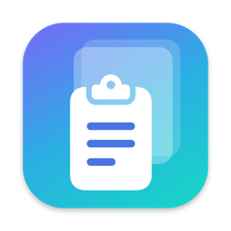

<p align="center">
  
</p>

<h1 align="center">ClipStack</h1>

<p align="center">
  <b>Clipboard history for macOS — a free, native Win+V for the Mac.</b><br>
  Remembers the text, images and screenshots you copy, and pastes any of them back with one shortcut.
</p>

<p align="center">
  
  
  
  
</p>

---

## Why

Windows has <kbd>Win</kbd>+<kbd>V</kbd>. macOS keeps exactly one thing on the clipboard, and the good
clipboard managers are paid. ClipStack is a small, open-source alternative: a menu-bar app with no
dependencies, no network access and no account. It just remembers what you copy.

## Features

- **Text, images and screenshots.** Formatting (RTF/HTML) is kept, so rich text pastes back as rich text.
  Screenshots taken with ⌘⇧4 (when set to save to the clipboard) are captured like any copy.
- **You choose the history size:** 10, 20, 50 or 100 items. When it's full, the oldest item is dropped.
- **Pin** items you reuse. Pinned items are kept forever and don't count toward the limit.
- **Paste straight into the app you're in.** Pick an item and it's pasted, just like Win+V.
- **Search as you type** (case- and accent-insensitive, any language), and filter by All / Text / Images / Pinned.
- **Keyboard first:** ↑↓, ↩, ⌘1…⌘9, ⇧↩ for plain text.
- **No duplicates:** copying something already in the history moves it to the top.
- **Private by default:** copies from password managers and Finder file copies are never recorded,
  and capturing can be paused from the menu bar.
- **Survives restarts:** history is saved to disk, and the app launches at login.
- **Native and light:** Swift + AppKit + SwiftUI with a Liquid Glass panel, about 60–80 MB of memory.

## Requirements

- macOS 26 (Tahoe) or later, Apple silicon or Intel
- Xcode 26 or later (to build from source)

## Install

ClipStack is distributed as source. Building takes about a minute.

```bash
git clone https://github.com/Lazar4o/ClipStack.git
cd ClipStack
scripts/install.sh
```

`install.sh` builds a release version, signs it, copies it to `~/Applications/ClipStack.app` and launches it.
Run it again after pulling updates; your history and settings are kept.

On first launch the Settings window opens:

1. Click **Grant Access…** and switch ClipStack on under
   *System Settings › Privacy & Security › Accessibility*. This lets ClipStack press ⌘V for you.
   Without it, picking an item only copies it.
2. Pick how many items to keep.
3. Press **⇧⌘V** anywhere.

### Recommended: a signing certificate (once, 2 minutes)

macOS ties the Accessibility permission to the app's signature. Without a certificate, every rebuild gets a
new ad-hoc signature, and the Accessibility switch stays on while pasting silently stops working.
A self-signed certificate keeps the signature stable:

1. Open **Keychain Access** → menu **Keychain Access › Certificate Assistant › Create a Certificate…**
2. Name `ClipStack Dev`, Identity Type **Self-Signed Root**, Certificate Type **Code Signing** → Create.
3. On the first build, macOS asks whether `codesign` may use the key: enter your login password and click
   **Always Allow**.

`build.sh` uses it automatically (or another identity via `SIGN_ID="Name" scripts/install.sh`) and falls
back to ad-hoc signing with a warning when it's missing.

## Usage

| Key | Action |
|---|---|
| <kbd>⇧⌘V</kbd> | Open / close the history (changeable in Settings) |
| type | Search |
| <kbd>↑</kbd> <kbd>↓</kbd> · <kbd>Page Up</kbd> <kbd>Page Down</kbd> | Move the selection |
| <kbd>↩</kbd> or click | Paste into the app you were in |
| <kbd>⇧↩</kbd> | Paste as plain text |
| <kbd>⌘1</kbd> … <kbd>⌘9</kbd> | Paste item 1–9 directly |
| <kbd>⌘P</kbd> | Pin / unpin |
| <kbd>⌘⌫</kbd> | Delete the item |
| <kbd>Tab</kbd> / <kbd>⇧Tab</kbd> | Next / previous filter (All · Text · Images · Pinned) |
| <kbd>Esc</kbd> | Clear the search; press again to close |
| <kbd>⌘,</kbd> | Settings |

Right-click an item for the same actions plus **Copy Without Pasting**.
The menu-bar icon opens the history with a left-click; a right-click shows **Keep Last**, **Pause Capturing**,
**Clear History…**, **Settings…** and **Quit**.

**Settings:** history size, shortcut recorder, paste or copy-only mode, panel position (mouse cursor or screen
center), capture text / images, launch at login, permission status and storage used.

> **Tip:** ⇧⌘V replaces "Paste and Match Style" in Chrome and Slack and "Markdown Preview" in VS Code.
> ⇧↩ in ClipStack pastes plain text, or record a different shortcut in Settings.

## Security & privacy

- **Nothing leaves your Mac.** No network code, no listening ports, no URL scheme, no AppleScript dictionary,
  no inter-process hooks in release builds, no third-party dependencies.
- **What is stored:** everything you copy, except copies marked as concealed or transient by password managers
  ([nspasteboard.org](http://nspasteboard.org) markers), copies made in Passwords, Keychain Access, 1Password and
  Bitwarden, and Finder file copies.
- **Where:** `~/Library/Application Support/ClipStack/` (`history.json` + `blobs/`), unencrypted, in a folder only
  your user can open; FileVault protects it at rest. A program already running as you could read it, just as it
  could read the clipboard. For sensitive work, pause capturing, delete items with ⌘⌫, or keep the limit small.
  Clipboard contents are never written to logs.
- **Accessibility** is used only to press ⌘V after you pick an item. The app is signed with the **hardened
  runtime**, so other programs can't inject code into it to borrow that permission.
- **Pasting into Terminal** pastes exactly what was copied, like ⌘V. Check commands copied from web pages before
  pasting them; they can hide extra lines.
- Copied images are decoded by macOS's own ImageIO to make thumbnails (the same decoder Preview uses).
- **Paste from Other Apps** (macOS 15.4+): if macOS asks whether ClipStack may read the clipboard, choose Allow.
  Settings › Clipboard access shows the current state.

## Troubleshooting

| Problem | Fix |
|---|---|
| Accessibility is on but nothing pastes | The signature changed (ad-hoc build). Remove ClipStack from the Accessibility list with "–" and add it again, or run `tccutil reset Accessibility local.tools.ClipStack` and grant it again. A [signing certificate](#recommended-a-signing-certificate-once-2-minutes) prevents this. |
| Menu-bar icon missing | On a MacBook it may be hidden behind the notch, or switched off in *System Settings › Menu Bar*. The shortcut still works. |
| Shortcut does nothing | Another app may own it; Settings shows a red note. Record a different shortcut. |
| Something else | `log stream --style compact --predicate 'subsystem == "local.tools.ClipStack"'` (types and sizes only, never contents). |

## Development

```
Sources/ClipStackCore   capture rules, storage, eviction, search  (pure logic, unit-tested)
Sources/ClipStack       the app: menu bar, glass panel, hotkey, paste, settings
Tests/                  XCTest suite; never touches the real clipboard
scripts/                build, install, icon and test helpers
docs/PLAN.md            design notes and the macOS gotchas behind them
```

```bash
swift test                          # unit tests
scripts/install.sh                  # build + install + relaunch (release)
scripts/fill-history.sh 15          # copy "clip 01"… "clip 15" (overwrites the clipboard)
swift scripts/test-image.swift      # put a 1440×900 PNG on the clipboard
swift scripts/test-concealed.swift  # fake password-manager copy, must NOT be recorded
swift scripts/make-icon.swift       # regenerate Resources/AppIcon.icns
```

How it works, briefly: ClipStack polls the pasteboard's change counter every 0.5 s (macOS has no clipboard
notification) and only reads contents when it changes. The history panel is a non-activating floating panel, so
the app you were typing in stays active; after you pick an item, ClipStack puts it on the clipboard, closes the
panel and sends ⌘V. The global shortcut uses Carbon `RegisterEventHotKey`, which needs no extra permission.

Debug hooks (render the panel to PNG, toggle it from scripts) exist only in debug builds:
`CONFIG=debug scripts/install.sh`, then `defaults write local.tools.ClipStack DebugHooks -bool YES`, relaunch,
and use `swift scripts/debug-hook.swift <toggle|query|snapshot|settings> [arg]`.
Run `scripts/install.sh` again to return to a release build.

## Uninstall

Quit ClipStack from its menu, then:

```bash
rm -rf ~/Applications/ClipStack.app "$HOME/Library/Application Support/ClipStack"
defaults delete local.tools.ClipStack
tccutil reset Accessibility local.tools.ClipStack
```

Remove it from *System Settings › General › Login Items* if it's still listed.

## License

[MIT](LICENSE) © 2026 Lazar4o
